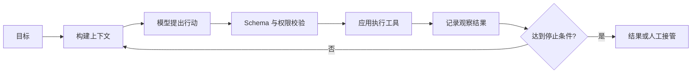

# Agent、聊天与 Workflow 的边界

聊天应用、Workflow 和 Agent 都可能调用同一个大模型。真正区分它们的不是页面长相，也不是 Prompt 长短，而是**下一步由谁决定、状态由谁持有、行动如何受控**。

## 聊天应用：一次输入对应一次生成

最小聊天应用的控制流是固定的：应用收集消息，调用模型，再展示结果。模型可以生成文本，但不会主动执行外部行动，也没有必须完成的任务状态。

聊天是很有价值的交互方式，也经常是 Agent 的前端入口；但聊天界面本身不是 Agent。判断系统类型时应该看后端执行模型，而不是看有没有消息气泡。

## Workflow：开发者预先确定路径

Workflow 把任务拆成明确节点，节点之间的连接由代码预先定义。例如“生成提纲 → 并行检索三个来源 → 汇总 → 人工审批 → 发布”。模型可以参与每个节点，但不能任意改变整体路径。

固定控制流带来几个优势：

- 行为容易预测和测试；
- 权限边界清晰；
- 成本和最长执行时间较容易估算；
- 适合合规、审批和不可逆操作。

它的代价是灵活性有限。遇到设计时没有预见的情况，Workflow 通常只能进入预设的错误分支或交给人工处理。

## Agent：在约束循环中动态选择行动

Agent 把目标、可用工具、当前状态和观察结果交给模型，让模型选择下一项行动。应用仍然掌握执行权：它校验结构、检查权限、调用工具、记录结果，并在停止条件满足时结束循环。

因此，“模型自主”不是“模型拥有无限权限”。一个可靠 Agent 的自主性存在于应用明确允许的动作集合内。

## 三者对比

| 维度 | 聊天应用 | Workflow | Agent |
| --- | --- | --- | --- |
| 下一步决策 | 用户再次输入 | 代码中的固定连接 | 模型在受限动作中选择 |
| 状态 | 消息历史为主 | 节点状态 | 目标、计划、step、观察与产物 |
| 外部行动 | 通常没有 | 预定节点执行 | 经校验后动态执行 |
| 停止方式 | 一次生成结束 | 到达终点节点 | 完成、预算耗尽、失败或人工暂停 |
| 可预测性 | 高 | 最高 | 相对较低，需要更强评测 |
| 合适场景 | 问答、改写、辅助创作 | 稳定业务流程 | 路径难以预先穷举的任务 |

## 实际产品通常是混合系统

“Workflow 还是 Agent”不是非此即彼的架构选择。更稳妥的产品通常用 Workflow 提供外层护栏，在某些节点内部使用 Agent 动态探索。例如研究助手可以采用以下组合：

1. Workflow 固定“计划、研究、审阅、发布”四个阶段；
2. Agent 在研究阶段根据证据缺口选择下一次检索；
3. 工具运行时限制可访问的来源、超时和最大调用次数；
4. 发布前必须经过确定性引用检查与人工审批。

这样，动态决策只出现在真正需要它的局部，其他部分继续使用更便宜、更容易验证的普通代码。

## 选择原则

从最简单的控制方式开始：

- 一次模型调用能解决，就使用聊天或结构化生成；
- 路径已知，就使用 Workflow；
- 只有当任务路径会随观察结果变化、且无法合理预先枚举时，才引入 Agent 循环；
- 对转账、删除、发布等高影响动作，即使由 Agent 提出，也应由确定性规则或人工确认执行。

Agent 工程的目标不是最大化自主性，而是在可接受的成本、风险和可解释性范围内，给系统恰到好处的决策空间。
