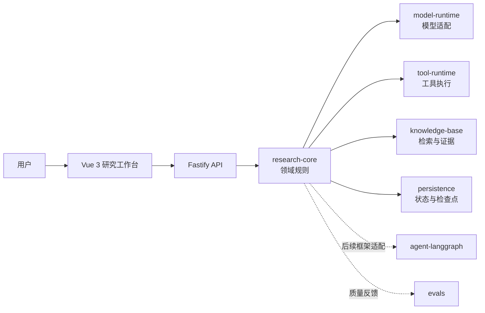
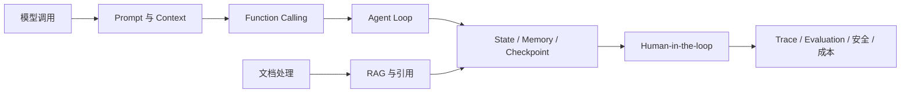

# 从前端应用走向 Agent 应用

## 本章目标

在本地跑起技术研究助手的网页和 API，认识接下来写代码会用到的目录。后面的模型调用、会话保存和资料检索都会在这套项目结构上继续做。

## 完成后的可见结果

装好依赖后，在仓库根目录运行 `pnpm dev`，可以同时启动 Vue 页面和 Fastify API。

| 打开的地址 | 看到的结果 |
| --- | --- |
| `http://localhost:5173` | 页面标题「AI 技术研究助手」和当前阶段说明。 |
| `http://127.0.0.1:3000/health/live` | `{ "status": "ok" }`，说明 API 进程能接收请求并返回 JSON。 |

如果启动日志显示了不同端口，使用日志里的地址。看完可以按 `Ctrl+C` 停止服务，再跟着下面的步骤练习。

## 前置条件

- 熟悉 JavaScript、TypeScript、组件、HTTP 请求和 `package.json`；
- 安装 [已验证版本](../reference/versions.md) 中的 Node.js 24 与 pnpm 11；
- 已取得本仓库代码；
- 本章不需要 `DASHSCOPE_API_KEY`，费用为 **¥0**。

先确认环境：

```text
node --version
pnpm --version
```

当前验证环境使用 Node.js `24.20.0` 和 pnpm `11.25.0`。

## 起始代码检查点

`chapter-02-start` 保存了使用 pnpm 11 的工程基线。可以从这个检查点创建练习分支，复跑第 1 章的应用。原始检查点见[章节表](../reference/chapter-map.md)。

```text
git switch -c learn/chapter-01 chapter-02-start
pnpm install --frozen-lockfile
```

如果分支名已经存在，换一个本地名称即可。安装完成后先运行：

```text
pnpm test
```

预期所有测试通过。若起点测试失败，应先解决环境差异，不要带着未知故障继续学习。

## 实现步骤

### 1. 看前端、应用和模型各做什么

后面的评审任务会比较项目 A 和 B 怎么导入文档、怎么在回答里标明资料出处。Vue 页面负责提交任务、展示进度和报告。应用保存已经查到的资料，并提供读取 README 的工具。模型根据已有资料提出下一步查什么，应用检查请求后执行。

| 前端概念 | Agent 工程中的对应概念 | 仍由谁负责 |
| --- | --- | --- |
| 用户事件 | Goal / 任务输入 | 应用接收并校验 |
| 组件状态 | Run State / 运行状态 | 应用持有 |
| API Client | Model Runtime / 模型适配器 | 应用封装 |
| 可调用后端接口 | Tool / 工具 | 应用定义权限与 Schema |
| 路由与状态机 | Workflow / Agent Loop | 应用控制边界 |
| 缓存与持久化 | Memory / Checkpoint | 应用选择和恢复 |
| DevTools 与埋点 | Trace / Evaluation | 应用记录并评测 |
| 页面组件 | Vue 工作台 | 只负责交互与展示 |

### 2. 区分聊天框、Workflow 与 Agent

| 方式 | 比较项目 A 和 B 时会发生什么 |
| --- | --- |
| 聊天框 | 用户问「两个项目怎么导入文档？」，模型根据收到的消息回答。 |
| Workflow | 开发者写好读 A 的 README、读 B 的 README、整理对照表的步骤，程序按顺序执行。 |
| Agent | 模型发现 B 的 README 缺少导入细节，提出再读 B 的导入文档。应用检查并执行，再把结果交回模型。 |

Agent 可以重复提出行动，直到任务完成或达到步数上限。

```ts
while (!state.done && state.steps < state.maxSteps) {
  const decision = await model.decide(buildContext(state))
  const action = validateDecision(decision)
  const observation = await tools.execute(action)
  state = recordObservation(state, observation)
}
```

`validateDecision` 检查模型提出的行动。`recordObservation` 把工具结果记进状态，供下一次决定用。

### 3. 认识仓库边界

仓库使用 pnpm workspace：

```text
apps/
  api/                  Fastify 入口与 HTTP 边界
  web/                  Vue 3 用户界面
packages/
  research-core/        不依赖框架的领域规则
  model-runtime/        千问等模型的统一适配边界
  tool-runtime/         工具注册、校验、权限与执行
  knowledge-base/       文档处理、检索、证据与引用
  persistence/          SQLite、状态与检查点
  agent-langgraph/      后期 LangGraph 适配层
  evals/                离线评测与回归数据
```

这套边界遵循一个简单规则：Vue 组件和 Fastify 路由可以调用领域能力，领域规则不能反过来依赖 UI 或 Web 框架。这样我们可以先用原生 TypeScript 理解 Agent，再在后期接入 LangGraph，而不必重写产品核心。

<details>
<summary>展开后续章节的调用关系</summary>

第 1 章先启动 Vue 页面和 Fastify API。图中的调用关系会在后续章节逐步接上。



</details>

### 4. 跑通 Fastify 健康检查

先构建 API：

```text
pnpm --filter @agent-book/api... build
pnpm --filter @agent-book/api start
```

保持这个终端运行，在浏览器打开 `http://127.0.0.1:3000/health/live`。看到 `{ "status": "ok" }`，就说明 Fastify 已启动并能响应请求。

### 5. 跑通 Vue 工作台

在新终端启动前端：

```text
pnpm --filter @agent-book/web dev
```

打开终端显示的本地地址，通常是 `http://localhost:5173`。页面应显示「AI 技术研究助手」。后续会在这个页面展示研究任务的进度和结果。

### 6. 看接下来会做什么

第 2 章先从 TypeScript 发出一次模型请求。第 3 章把每轮问答存起来，让不同用户各自续聊。到第 4 章，模型会为上面比较项目 A 和 B 的任务生成研究计划。

<details>
<summary>展开全书的学习顺序</summary>



</details>

## 每一步的验证方式

| 步骤 | 验证方式 | 成功信号 |
| --- | --- | --- |
| 环境准备 | `node --version`、`pnpm --version` | 大版本分别为 24 与 11 |
| 安装依赖 | `pnpm install --frozen-lockfile` | lockfile 未被改写且命令退出码为 0 |
| 理解边界 | 找出 Vue、Fastify 与 `research-core` 的方向 | 领域包不依赖 UI 或 HTTP 框架 |
| API smoke | 请求 `/health/live` | 返回 `{ "status": "ok" }` |
| Web smoke | 打开 Vite 本地地址 | 显示“AI 技术研究助手” |
| 仓库门禁 | 运行下方五条验收命令 | 所有命令退出码为 0 |

如果只想快速确认本章结构和自动化门禁，可以运行：

```text
pnpm chapter:check -- 01
```

## 常见错误

### 把聊天框误当成 Agent

我们最初最容易画出的产品图只有“输入框 → 大模型 → 消息气泡”。它能聊天，但没有目标状态、工具协议、行动循环、停止条件、证据记录和失败恢复，因此不能证明系统具备 Agent 能力。

排查时不要先问“页面像不像 ChatGPT”，而要依次问：

1. 当前目标和运行状态保存在哪里？
2. 模型可以选择哪些行动，参数由什么 Schema 校验？
3. 工具结果如何作为 observation 回到下一步？
4. 什么条件会完成、暂停或终止运行？
5. 失败后能否定位到具体 step，并安全恢复？

本章的修正方式是先把领域、模型、工具、知识库、持久化和评测边界留出来。页面只展示状态，不承担 Agent 决策。

### 把健康检查当成完整就绪检查

`/health/live` 返回 `ok` 只代表进程存活。后续接入模型、SQLite 和 Qdrant 后，还需要区分 liveness 与 readiness，避免外部依赖故障时给出错误的可用性信号。

## 最终验收

停止本章手动启动的开发服务器，然后在仓库根目录依次执行：

```text
pnpm lint
pnpm typecheck
pnpm test
pnpm docs:check
pnpm build
```

验收标准：

- 五条命令全部通过；
- API 健康检查返回 `ok`；
- Vue 页面显示项目标题；
- 没有配置或调用任何付费模型，实测成本为 **¥0**；
- 你能用自己的话解释聊天框、Workflow 和 Agent 的区别。

## 延伸练习

1. 画一张你熟悉的前端应用架构图，再标出如果加入 Agent，哪些边界需要新增。不要接模型。
2. 给 `/health/live` 增加一个测试用例，尝试解释为什么这里使用 Fastify `inject()` 比启动真实端口更稳定。
3. 在不改领域包的前提下替换 Vue 页面文案，体会“产品界面可以变化，核心规则不应被迫变化”的边界。

练习不要求新增依赖、API Key 或在线服务，也不应改变本章验收结果。

## 相关解释与参考

- [Agent、聊天与 Workflow 的边界](../explanations/agent-vs-workflow.md)
- [Agent 工程术语表](../reference/glossary.md)
- [章节与代码检查点映射](../reference/chapter-map.md)
- [已验证版本](../reference/versions.md)
- [在本地启动应用与教程站](../how-to/run-project-locally.md)
- [编写并验收一章教程](../how-to/author-a-chapter.md)
